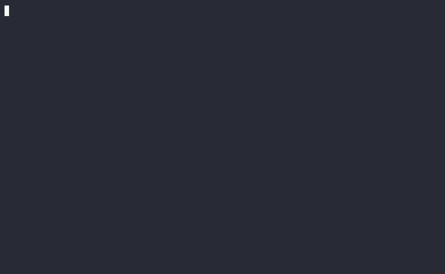

# ValutaTrade Hub

Консольный кошелек для работы с фиатными валютами и криптовалютами.
Пользователи и портфели хранятся в data/users.json и data/portfolios.json.
Курсы берутся из CoinGecko и ExchangeRate-API.

## Установка и запуск

Для запуска нужен Python 3.12 или новее и uv.

**Запуск с обновлением курсов**

```bash
uv sync
export COINGECKO_API_KEY='<ключ CoinGecko>'
export EXCHANGERATE_API_KEY='<ключ ExchangeRate-API>'
uv run valutatrade-hub
```

После запуска нужно ввести `update-rates` внутри программы, чтобы загрузить курсы.

**Запуск без API-ключей**

```bash
uv sync
uv run valutatrade-hub
```

Без ключей можно зарегистрироваться, войти и выполнить сделки с USD.
Для операций, которым нужен обменный курс, в кеше уже должен быть свежий курс.

## Основные операции

- `register --username <имя> --password <пароль>` - регистрация пользователя;
- `login --username <имя> --password <пароль>` - вход в аккаунт;
- `show-portfolio [--base <валюта>]` - вывод балансов и общей стоимости портфеля;
- `buy --currency <валюта> --amount <количество>` - покупка валюты;
- `sell --currency <валюта> --amount <количество>` - продажа валюты;
- `exit` - выход из программы.

При регистрации создается пустой портфель. Используется упрощенная модель, 
в которой buy увеличивает баланс выбранной валюты, а sell уменьшает его. 
Сумма в USD выводится справочно. Если валюты для продажи не хватает, программа выводит
ошибку и сохраняет прежний баланс. По умолчанию портфель оценивается в USD.

## Курсы валют и кеш

- `update-rates [--source coingecko|exchangerate]` - обновление курсов. По умолчанию используются оба источника;
- `show-rates [--currency <валюта>] [--top <число>] [--base <валюта>]` - вывод курсов из кеша. `--top` выводит самые дорогие криптовалюты;
- `get-rate --from <валюта> --to <валюта>` - вывод прямого и обратного курса.

Последние курсы хранятся в data/rates.json, а история обновлений в
data/exchange_rates.json. По умолчанию курс актуален 300 секунд.
Этот срок можно изменить через rates_ttl_seconds в секции
[tool.valutatrade] файла pyproject.toml. Если курс устарел или отсутствует,
get-rate один раз пытается обновить кеш.

Успешные и неудачные сделки записываются в logs/actions.log. Ход обновления
курсов записывается в logs/parser.log.

## Структура проекта

- `valutatrade_hub/core/` - модели, операции с портфелем и расчет курсов;
- `valutatrade_hub/cli/` - обработка команд;
- `valutatrade_hub/infra/` - настройки и доступ к JSON;
- `valutatrade_hub/parser_service/` - запросы к API, обновление кеша и запись истории.

## Пример работы

Ниже показан пример работы:



Чтобы воспроизвести [запись asciinema](demo/demo.cast) в терминале, нужно выполнить:

```bash
uvx asciinema play demo/demo.cast
```
